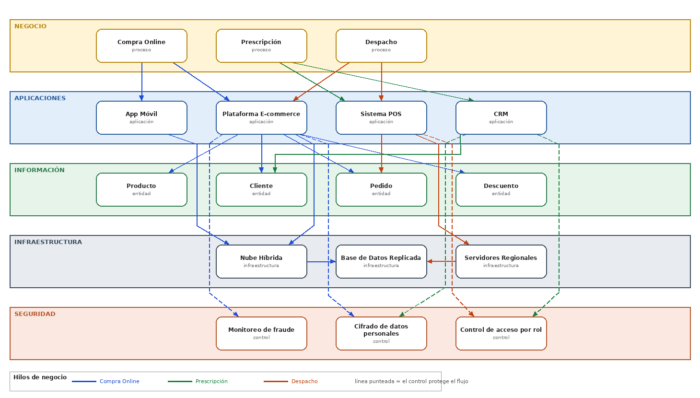

# Registro de Trabajo en Clase - Taller 8

## Fecha de la sesión
_Completar con la fecha de la clase._

## Integrantes presentes
- Jorge Alarcón
- Julián Aguirre
- Brayan Presiga

_(Equipo ARQUITECH)_

## Actividades realizadas en clase

Se siguió la metodología de 5 pasos de la [guía paso a paso](guia_paso_a_paso_integracion.md) sobre el caso base de FarmApp. El tablero se construyó en draw.io: [`tablero-farmapp.drawio`](tablero-farmapp.drawio).

1. **Capas.** Se organizaron las 5 vistas como bandas horizontales, de arriba abajo: Negocio, Aplicaciones, Información, Infraestructura y Seguridad.
2. **Elementos.** Se ubicaron los 17 elementos del caso dentro de su capa, sin conectar: 3 procesos, 4 aplicaciones, 4 entidades, 3 piezas de infraestructura y 3 controles de seguridad.
3. **Relaciones verticales.** Se trazó primero el hilo **Compra Online** (el de la guía) y luego, con el mismo método, **Prescripción** y **Despacho**. Cada hilo tiene un color distinto y los controles de seguridad se dibujan con línea punteada (protegen un flujo; no lo transportan).
4. **Narrativa.** Ver la sección siguiente.
5. **Revisión de huérfanos.** Con los tres hilos trazados, ninguno de los 17 elementos queda sin conexión (tabla más abajo).

### Decisiones de modelado

- **Hilo de Compra Online:** se tomó tal cual está en la guía.
- **Hilos de Prescripción y Despacho:** la guía solo traza Compra Online y deja los otros dos como trabajo pendiente. Las conexiones de esos dos hilos son **supuestos nuestros** sobre el caso, no datos del enunciado:
  - Prescripción → CRM (historial del paciente) y → Sistema POS (validación de la receta en mostrador).
  - Despacho → Sistema POS (entrega en tienda) y → Plataforma E-commerce (pedidos en línea por despachar).
- **Seguridad como controles por flujo:** cada hilo se asocia al control que lo protege.
  - Compra Online: Cifrado de datos personales (pago electrónico) y Monitoreo de fraude.
  - Prescripción: Cifrado (el historial de salud es dato sensible) y Control de acceso por rol (solo personal autorizado ve la receta).
  - Despacho: Control de acceso por rol en el POS (cajero y farmacéutico no tienen los mismos permisos).
- **Infraestructura:** Nube Híbrida → Base de Datos Replicada (Compra Online, decisión del Taller 4). Los Servidores Regionales sostienen el POS en tienda y replican a la base de datos (Despacho).
- **Caso base vs. cliente real:** FarmApp no tiene etiquetas NUEVO porque no hay TO-BE; esa marca se usa en la Parte 2 (Taller 7).

### Narrativa de coherencia (Paso 4)

**Compra Online.** Se apoya en la Plataforma E-commerce y en la App Móvil, priorizadas porque la mayoría de las compras ya ocurren desde dispositivos móviles. Ambas comparten las entidades Producto, Cliente, Pedido y Descuento para evitar inconsistencias de inventario entre canales, y corren sobre la Nube Híbrida con Base de Datos Replicada para tolerar picos de demanda en campañas. El cifrado y el monitoreo de fraude se aplican en la plataforma porque el proceso involucra pago electrónico.

**Prescripción.** Se apoya en el CRM, que guarda el historial del cliente, y en el POS, donde la receta se valida al dispensar. Como la receta es un dato de salud, el CRM se conecta al cifrado de datos personales y al control de acceso por rol: ver una prescripción no debe estar al alcance de cualquier usuario del sistema.

**Despacho.** Se apoya en el POS (entrega en tienda) y en la Plataforma E-commerce (pedidos en línea). Ambos convergen en la entidad Pedido, de modo que un pedido tiene un solo estado sin importar el canal. El POS usa los Servidores Regionales para seguir operando en tienda y replica a la Base de Datos Replicada; el control de acceso por rol separa lo que puede hacer cada cargo en caja.

### Verificación de elementos huérfanos (Paso 5)

| Elemento | Capa | Hacia arriba | Hacia abajo |
|---|---|---|---|
| Compra Online / Prescripción / Despacho | Negocio | — (capa más alta) | App Móvil, E-commerce, CRM, POS |
| App Móvil | Aplicaciones | Compra Online | Nube Híbrida |
| Plataforma E-commerce | Aplicaciones | Compra Online, Despacho | Producto, Cliente, Pedido, Descuento, Nube, Fraude, Cifrado |
| Sistema POS | Aplicaciones | Prescripción, Despacho | Pedido, Servidores Regionales, Control de acceso |
| CRM | Aplicaciones | Prescripción | Cliente, Cifrado, Control de acceso |
| Producto | Información | E-commerce | — (no se trazó su relación con Infraestructura) |
| Cliente | Información | E-commerce, CRM | — (ídem) |
| Pedido | Información | E-commerce, POS | — (ídem) |
| Descuento | Información | E-commerce | — (ídem) |
| Nube Híbrida | Infraestructura | E-commerce, App Móvil | Base de Datos Replicada |
| Base de Datos Replicada | Infraestructura | Nube Híbrida, Servidores Regionales | — |
| Servidores Regionales | Infraestructura | POS | Base de Datos Replicada |
| Cifrado / Monitoreo de fraude / Control de acceso | Seguridad | E-commerce, CRM, POS | — (capa más baja) |

La capa de Información no baja a Infraestructura en ningún hilo (igual que en el ejemplo de la guía): la relación se da a través de las aplicaciones que acceden a la base de datos.

## Boceto inicial del modelo

## Retroalimentación del docente

_Pendiente: registrar aquí los comentarios recibidos en la sesión._

## Tareas definidas para complementar el taller

| Tarea asignada | Responsable | Fecha estimada |
|----------------|-------------|----------------|
| Tablero integrado del cliente real (AS-IS + TO-BE del Taller 7) en `entrega/tablero-integrado-cliente.drawio` | _por asignar_ | _por definir_ |
| Informe en `entrega/informe.md` con reflexión crítica | _por asignar_ | _por definir_ |
| Investigación y `entrega/referencias.md` | _por asignar_ | _por definir_ |

---

_Este documento resume el trabajo colaborativo realizado durante la sesión del Taller 8 en el curso AREM - Universidad de La Sabana._
